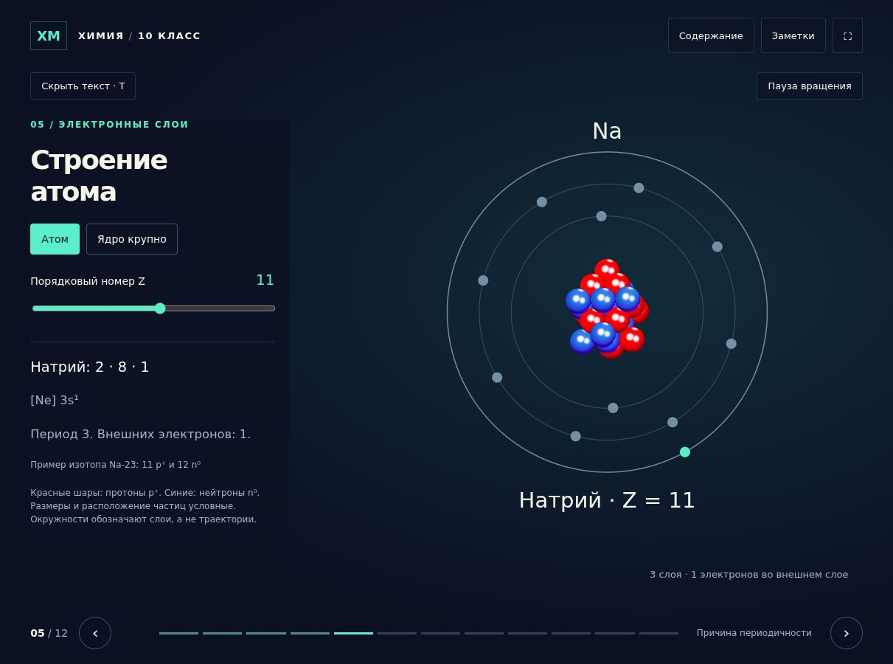
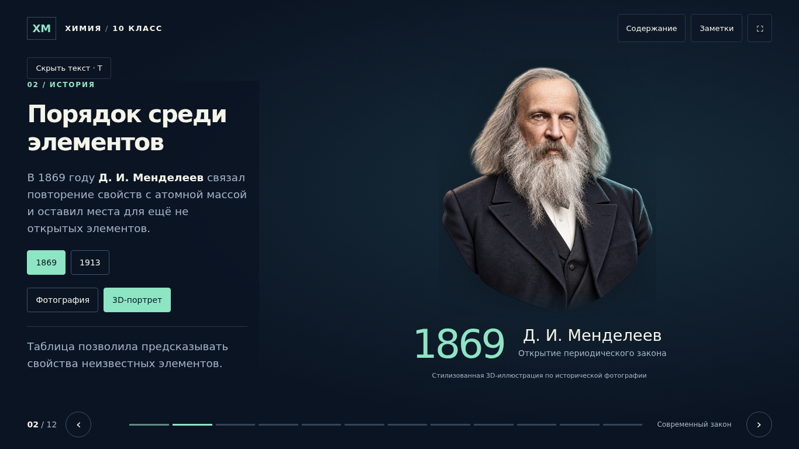
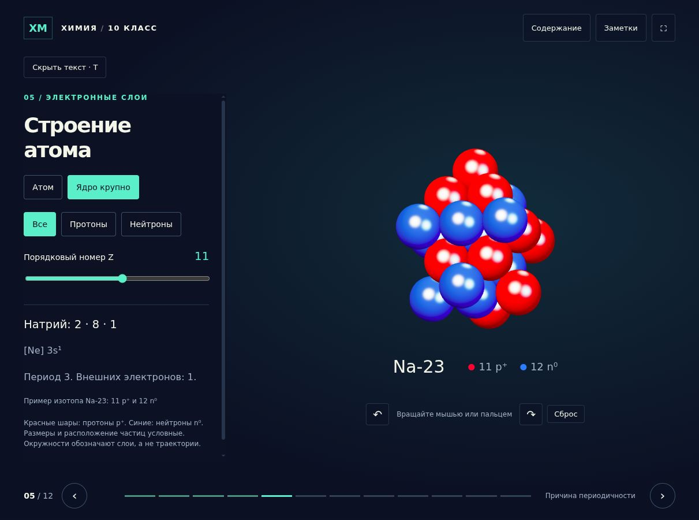

<div align="center">

# Периодический закон

### Интерактивная презентация по химии для 10 класса

Таблица элементов, объёмное ядро и электронные слои.<br>
Исследование, которое можно показать на уроке и пройти самостоятельно.

[](https://xondell.github.io/periodic-law-10/)
[](https://xondell.github.io/periodic-law-10/downloads/periodic-law-10.zip)

**12 разделов** · **118 элементов** · **3D-модели** · **5 вопросов в тесте**



</div>

## Что можно исследовать

- **Таблицу Менделеева.** Выбрать любой из 118 элементов, узнать его порядковый номер и выделить период или группу.
- **Строение атомов.** Менять Z от 1 до 20 и видеть соответствующее распределение электронов по слоям.
- **Ядро в 3D.** Рассмотреть красные протоны и синие нейтроны, повернуть модель и включить подсветку частиц.
- **Третий период.** Открыть любой атом от Na до Ar и посмотреть его адрес, электронное строение и соединения.
- **Закономерности в группе.** Сравнить Li, Na и K, расположенные сверху вниз, разобрать серу и найти неизвестный элемент.
- **Историю открытия.** Переключаться между Менделеевым и Мозли, историческими фотографиями и стилизованными 3D-портретами.
- **Своё понимание.** Пройти тест из пяти вопросов с объяснениями и итоговым результатом.

Модель вращается автоматически, пока открыт слайд с атомом. Кнопка **«Пауза вращения»** останавливает движение. Ручной поворот мышью или пальцем сохраняется.

<table>
<tr>
<td width="50%"></td>
<td width="50%"></td>
</tr>
<tr>
<td align="center">История и портреты учёных</td>
<td align="center">Объёмное ядро и состав изотопа</td>
</tr>
</table>

## Содержание

| № | Раздел |
|:--:|---|
| 01 | Периодический закон |
| 02 | Открытие закона |
| 03 | Современная формулировка |
| 04 | Периоды и группы |
| 05 | Строение атома и ядро крупным планом |
| 06 | Атомы третьего периода и их характеристики |
| 07 | Изменение свойств в периоде |
| 08 | Изменение свойств в группе |
| 09 | Характеристика серы |
| 10 | Неизвестный элемент |
| 11 | Проверка знаний |
| 12 | Итоги и источники |

## Управление

| Действие | Клавиши или кнопки |
|---|---|
| Следующий / предыдущий слайд | `→` / `←`, кнопки внизу |
| Первый / последний слайд | `Home` / `End` |
| Перейти к нужному разделу | «Содержание» или шкала внизу |
| Полноэкранный показ | `F` или `⛶` |
| Скрыть / показать текст | `T` |
| Заметки к слайду | `N` |
| Закрыть открытое окно | `Esc` |
| Остановить / включить вращение | Кнопка в правом верхнем углу |
| Повернуть ядро | Перетащить мышью или пальцем |

> Заметки открываются на текущем экране. При трансляции экрана их увидят зрители.

На телефоне текстовая панель прокручивается, а широкую таблицу элементов можно прокрутить по горизонтали. При системной настройке уменьшения движения автоматическое вращение изначально выключено; его можно включить кнопкой.

## Запуск

**Онлайн:** [открыть презентацию в браузере](https://xondell.github.io/periodic-law-10/). Регистрация и установка не нужны.

**Без интернета:** [скачать архив с одним HTML-файлом](https://xondell.github.io/periodic-law-10/downloads/periodic-law-10.zip), распаковать и открыть `periodic-law-10.html` в современном браузере. Все изображения и библиотеки уже внутри. Внешние ссылки на источники требуют подключения к сети.

**Из исходников:** скачать репозиторий и открыть `index.html`. Для локального просмотра через сервер:

```bash
python3 -m http.server 8000
```

Затем открыть [localhost:8000](http://localhost:8000). Сборка и установка зависимостей не нужны.

## Как устроен проект

```text
index.html                 Слайды, оформление и взаимодействия
assets/nucleus.js          3D-модели, вращение и подсветка частиц
assets/three.min.js        Локальная библиотека Three.js
assets/*-photo.jpg         Исторические фотографии
assets/*-3d.png            Стилизованные портреты
assets/PORTRAIT-PROMPTS.md  Промпты и сведения о портретах
docs/images/               Скриншоты для README
downloads/                 Офлайн-версия одним файлом
```

Презентация использует HTML, CSS и обычный JavaScript. Three.js 0.160.1 отвечает за объёмное ядро. Работа с моделью происходит в браузере, серверная часть и внешние API не нужны. Если WebGL недоступен, вместо объёмного ядра появляется упрощённая схема.

GitHub Pages публикует содержимое ветки `main` из корня репозитория. Файл `.nojekyll` сохраняет обычную статическую структуру сайта. Чтобы обновить презентацию, достаточно внести изменения и отправить их в `main`.

## Учебные оговорки

Ядро увеличено относительно электронной оболочки. Размеры, расположение шаров и окружности электронных слоёв условны. Движущиеся отметки не изображают реальные траектории электронов.

Для каждого из первых 20 элементов показан один пример изотопа. Число протонов равно Z, число нейтронов равно A − Z. Стилизованные 3D-портреты учёных созданы с помощью ИИ по историческим фотографиям и подписаны как иллюстрации.

## Источники и атрибуция

- [IUPAC — периодическая таблица](https://iupac.org/what-we-do/periodic-table-of-elements/)
- [Royal Society of Chemistry — развитие периодической системы](https://periodic-table.rsc.org/history/about)
- [Royal Society of Chemistry — атомный номер и работы Мозли](https://www.rsc.org/news/2019/january/finding-the-periodic-table)
- [OpenStax — электронное строение атомов](https://openstax.org/books/chemistry-2e/pages/6-4-electronic-structure-of-atoms-electron-configurations)
- [OpenStax — периодические свойства элементов](https://openstax.org/books/chemistry-2e/pages/6-5-periodic-variations-in-element-properties)

Фотографии Менделеева и Мозли опубликованы на Wikimedia Commons как общественное достояние. Подробные ссылки, сведения о библиотеке и лицензиях находятся в [THIRD_PARTY_NOTICES.md](THIRD_PARTY_NOTICES.md). Промпты для стилизованных портретов сохранены [отдельно](assets/PORTRAIT-PROMPTS.md).
